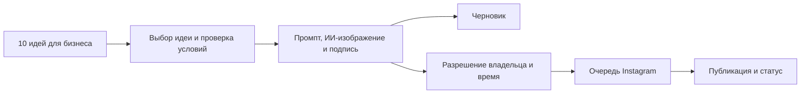

# AulieAta AI

**ИИ-платформа для управления и продвижения малого бизнеса.**

Клиенты, заказы, команда и маркетинг в едином рабочем пространстве.

Проект для **Digital Taraz Hackathon** · Тараз, Казахстан

Автор: **Акимов Алимжан** · Репозиторий: **iTU**

[Открыть приложение](https://itudron.ru/) · [Презентация для хакатона](docs/presentation/AulieAta-AI-Digital-Taraz-pitch.pdf) · [Установка](docs/SETUP.md) · [История разработки и проверок](docs/DEVELOPMENT-STATUS.md) · [Переводы и объявления администратора](docs/ANNOUNCEMENTS-AND-TRANSLATIONS.md)

---

## Что делает AulieAta AI

Предпринимателю приходится отвечать клиентам, следить за заказами, организовывать работу и готовить публикации. AulieAta AI связывает эти задачи с каталогом, ценами и правилами конкретного бизнеса.

Клиент обращается в Telegram, получает консультацию, выбирает товары или время посещения и подтверждает заказ. Владелец работает в веб-кабинете: управляет каталогом и командой, задаёт вопросы голосом, выбирает идеи продвижения и назначает время публикации.

## Возможности

| Направление | Что доступно |
| --- | --- |
| **Голосовой ИИ** | Голосовые сообщения и ответы в Telegram; голосовой запрос владельца и озвучивание результата в приложении. Русский, казахский и смешанная речь, учёт недавнего диалога. |
| **Telegram-помощник** | Ответы по публичной базе знаний, каталог, подбор по бюджету, корзина из нескольких позиций, подтверждение и статус заказа, пошаговая запись и передача обращения сотруднику. |
| **ИИ-маркетолог** | Подборка из 10 идей акций, мероприятий и постов с учётом сферы, аудитории, языка и даты. Для выбранной идеи — визуальное задание, изображение и подпись. |
| **Контент-студия** | Нейрогенерация через Cloudflare Workers AI, библиотека изображений, шаблонные карточки с собственным фото, приватные черновики и предпросмотр. |
| **Автопубликация Instagram** | Отправка согласованных материалов сразу или по расписанию, выбранные дни и время, статусы, отмена и защита от повторной отправки. |
| **Работа бизнеса** | Каталог, клиенты, заказы, партии и сроки годности, резерв и списание, состав блюд, расписание, переносы и напоминания. |
| **Помощник владельца** | План действий по запросу, импорт прайса из фото, текста или таблицы, сравнение поставщиков, передача смены в задачи, просмотр изменений и отмена поддерживаемых действий. |
| **Команда и знания** | Роли сотрудников, обращения к человеку, публичная база для клиентов и внутренние сведения для владельца, карточки обслуживания и отзывы по QR. |
| **28 сфер бизнеса** | Отраслевые разделы, названия каталога и записи, темы контента и настройки продвижения. Данные и подключения разделены по рабочим пространствам. |

Дополнительные ИИ-инструменты помогают готовить коммерческие предложения, анализировать расходы, писать ответы на отзывы, разбирать документы, составлять бизнес-планы и материалы для команды. Владелец проверяет результат перед использованием.

## От идеи до публикации



1. ИИ предлагает идеи с учётом профиля бизнеса и предыдущих подборок.
2. Владелец выбирает идею, проверяет текст, цены, скидку или условия мероприятия.
3. Можно сохранить черновик либо заранее разрешить публикацию выбранного материала после подготовки.
4. Сервер создаёт изображение и пост, затем отправляет его в подключённый Instagram в выбранное время.
5. Результат отображается в контент-студии. При неопределённом результате отправка автоматически не повторяется.

Расписание работает на сервере через `cron`: компьютер владельца может быть выключен. Время публикаций задаётся пользователем в **UTC+5**. Изменённый материал требует нового подтверждения; недельное расписание распределяет выбранные посты, а не запускает бесконечную генерацию.

## Telegram как помощник по обслуживанию

Пример обращения: **«Посоветуй кофе и выпечку до 2 500 ₸»**.

Бот использует доступные позиции каталога, помогает собрать корзину и предлагает подтвердить заказ. Цены и наличие проверяются сервером. При настроенной записи клиент последовательно выбирает услугу, специалиста и свободное время. Жалоба, вопрос о возврате или просьба связаться с человеком передаются сотруднику.

Есть три режима:

| Режим | Назначение |
| --- | --- |
| **Без внешнего ИИ** | Каталог, точные справочные ответы и пошаговые действия без генеративной модели. |
| **Cloudflare** | Свободный текстовый диалог с использованием публичных данных бизнеса. |
| **Gemini с голосом** | Распознавание голосовых сообщений, ИИ-ответы и озвучивание; зависит от доступной квоты Gemini. |

Голосовой ответ можно переключить на текстовый. Cloudflare-режим остаётся текстовым. Внутренние сведения владельца не передаются публичному консультанту.

## Чем выделяется проект

- **Единые данные бизнеса.** Каталог, цены и правила используются в обслуживании, заказах и подготовке контента.
- **Голос на русском и казахском.** Клиент может отправить голосовое сообщение, а владелец — надиктовать задачу или прослушать ответ.
- **Связь обслуживания и продвижения.** Telegram-помощник, ИИ-идеи, изображения и Instagram работают в одном кабинете.
- **Адаптация к сфере.** Кафе, магазины, салоны, обучение, автосервисы и другие направления получают свои разделы и темы.
- **Контроль владельца.** Предпросмотр, подтверждения, роли, отдельные данные бизнесов и сохранённые статусы действий.

Это сочетание возможностей и фокус на малом бизнесе Казахстана; отдельные функции могут встречаться и в других продуктах.

## Подключения и развитие

| Интеграция | Текущий объём |
| --- | --- |
| **Telegram Bot API** | Обслуживание, заказы, запись, сообщения и голосовой режим. |
| **Cloudflare Workers AI** | Текстовые идеи, диалог и генерация изображений с очередью и лимитами. |
| **Google Gemini** | ИИ-инструменты, распознавание речи и голосовые ответы. |
| **Instagram** | Подключение профессионального аккаунта по токену Meta Developers и очередь публикаций. Массовое OAuth-подключение сторонних бизнесов ещё предстоит реализовать. |
| **TikTok Login Kit** | OAuth-подключение и проверка профиля, зашифрованное хранение токенов. |
| **Публикации и рекламные кампании TikTok** | **В планах.** Нужны отдельная интеграция, разрешения и проверка платформы; реклама также потребует бюджета владельца. |

Дальнейшее развитие: пилот с предпринимателями Тараза, измерение времени обслуживания и подготовки контента, удобное подключение сторонних бизнесов и расширение каналов публикации.

WhatsApp Cloud API, Google Calendar OAuth, платежи, сбор отзывов из 2GIS/Google Maps и автоматическая синхронизация с Kaspi/1С пока не подключены.

## Бесплатная генерация и настройка бизнеса

Cloudflare Workers AI используется в пределах бесплатной квоты при сохранении тарифа **Workers Free**. В приложении есть собственные ограничения и учёт попыток: они помогают контролировать расход, но не гарантируют доступность общей квоты провайдера. Приложение не включает платную подписку автоматически. Голосовой режим отдельно зависит от квоты Gemini.

Перед приёмом реальных заказов владелец заполняет каталог, цены, наличие, рабочие часы и правила получения, затем включает нужные сценарии. Демонстрационные позиции и заказы помечаются отдельно и не учитываются как реальные продажи. Бот не проводит платежи и не принимает решения о денежных возвратах.

## Технологии и структура

**Сервер:** PHP 8.1+ · MySQL/MariaDB · ежеминутный cron

**Интерфейс:** JavaScript · HTML/CSS

**Проверки разработки:** Node.js и PHP

| Путь | Содержимое |
| --- | --- |
| `public/` | PHP-приложение, JavaScript и обработчики интеграций; корень веб-сайта. |
| `database/schema.sql` | Базовая схема новой базы без пользовательских данных. |
| `tools/` | Миграция и служебные команды. |
| `tests/` | Проверки исходников, бизнес-сценариев, интеграций и HTTP-доступа. |
| `aulieata-secrets.example.php` | Пустой шаблон приватной конфигурации. |
| `docs/` | Инструкции, результаты проверок и PDF-презентации. |

## Запуск

Полная последовательность и параметры интеграций — в [SETUP.md](docs/SETUP.md).

1. Подготовьте PHP 8.1+ с PDO MySQL, mbstring, cURL, OpenSSL и GD, базу MySQL/MariaDB и HTTPS.
2. Создайте приватную конфигурацию по `aulieata-secrets.example.php` **вне `public/`**. Укажите параметры базы, адрес сайта и нужные подключения.
3. Из корня репозитория выполните миграцию:
   ```sh
   php tools/migrate.php
   ```
4. Направьте корень сайта на `public/`, а `public/cron.php` запускайте раз в минуту.
5. Войдите в приложение, выберите сферу, заполните данные бизнеса и настройте каналы.

Автоматическое развёртывание из GitHub не настроено: размещение на хостинге выполняется отдельно.

## Проверки и документация

```sh
npm ci
npm test
```

Интеграционные и HTTP-проверки запускаются отдельно на локальной базе с префиксом `itu_test_`. Команды и требования приведены в [инструкции](docs/SETUP.md#изолированные-проверки).

В [истории разработки](docs/DEVELOPMENT-STATUS.md) зафиксированы проверки заказов, расписания, конкурирующих запросов, ролей, Instagram, TikTok, генерации изображений и ИИ-идей. Автоматические проверки внешних API используют подставные ответы; реальные проверки описаны отдельно с их границами.

- [Презентация для Digital Taraz Hackathon](docs/presentation/AulieAta-AI-Digital-Taraz-pitch.pdf)
- [Обзор проекта в PDF](docs/presentation/AulieAta-AI-project.pdf)
- [Установка и подключения](docs/SETUP.md)
- [Режим «Новичок в бизнесе»](docs/BEGINNER-GUIDE.md)
- [История разработки](docs/DEVELOPMENT-STATUS.md)
- [Сведения о сторонних компонентах](THIRD_PARTY_NOTICES.md)

Рабочие API-ключи, пароли, клиентская переписка, записи голоса и резервные копии не должны попадать в Git. Подключённые токены хранятся на сервере в зашифрованном виде; управление ими доступно владельцу рабочего пространства.
